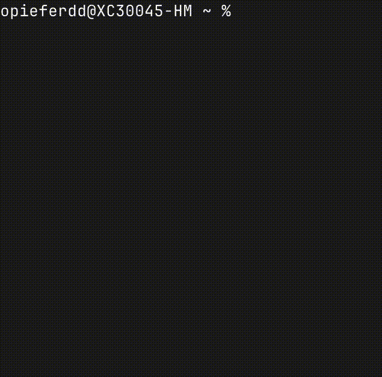

# workflowMode

**A lightweight cross-platform workflow mode for long-running AI coding tools, builds and automations.**

By [opieferd](https://github.com/opieferd).


Keep Claude Code, Codex, builds, downloads and other long-running jobs active while **dimming the built-in display, muting audio output, and preventing idle sleep**. On supported desktops, ordinary keyboard and mouse input is filtered for up to **60 minutes**, then released while the workflow keeps running.

> **Power savings:** This reduces display/backlight consumption, not total system power. AI workloads continue consuming resources; intentionally preventing sleep uses more power than letting the computer suspend. **macOS is field-tested on the author's M2; Linux and Windows versions are new and not yet hardware-verified.**

## Features & platform support

| Capability | macOS | Linux | Windows |
| --- | --- | --- | --- |
| Built-in display brightness | 0% via BetterDisplay | 0% via brightnessctl | 0% via laptop WMI |
| Keyboard backlight | Off via kbdlight | Off if a supported LED is exposed | Not supported (vendor-specific) |
| Output audio | Muted; previous mute state restored | Muted via PipeWire/PulseAudio; restored | Muted via Windows Core Audio; restored |
| Keep awake | `caffeinate -di` | `systemd-inhibit` | `SetThreadExecutionState` |
| Input filter | Quartz event tap (60 min) | X11 active grabs (60 min); **not on Wayland** | Windows low-level hooks (60 min) |
| `--test` | 20% screen, 30 sec | 20% screen, 30 sec | 20% screen, 30 sec |
| `--check` | Read-only preflight | Read-only preflight | Read-only preflight |
| Ctrl+C | Exit & restore | Exit & restore | Exit & restore |
| On input timeout | Unlocks only; workflow stays active | Same on X11 | Same |

**Input filtering is best-effort and not a security lock.** It may not intercept privileged shortcuts, remote input, or other OS-level events. **First run `--check` and `--test`, and prepare an independent recovery method before attempting a 0% screen.**

## Platform scripts

- **macOS:** [`workflow.py`](workflow.py) and [`requirements.txt`](requirements.txt) — tested on the author's MacBook Air M2.
- **Linux:** [`workflow_linux.py`](workflow_linux.py) and [`requirements_linux.txt`](requirements_linux.txt) — designed for modern systemd desktop Linux with controllable laptop backlight; input suppression on **X11 only**.
- **Windows:** [`workflow_windows.py`](workflow_windows.py) and [`requirements_windows.txt`](requirements_windows.txt) — designed for Windows 10/11 laptops with a WMI-compatible internal screen; external monitors and keyboard backlights are **not universally supported**.

Each platform can be installed from the same repository. Platform-specific release ZIPs are generated by [the release workflow](.github/workflows/platform-releases.yml), if GitHub Actions is enabled.

## macOS requirements

- macOS, developed on an **M2 MacBook Air** (other models may need adjustments)
- [Homebrew](https://brew.sh/), Python 3, Node.js/npm
- [BetterDisplay](https://betterdisplay.pro/) installed in `/Applications` (uses its built-in CLI; **no full Xcode installation required**)
- [macos-keyboard-backlight](https://www.npmjs.com/package/macos-keyboard-backlight), providing `kbdlight`
- Python package `pyobjc-framework-Quartz`
- Accessibility permission for your terminal; Input Monitoring if prompted

## macOS estimated download size (including dependencies)

| Component | Estimated Download |
|---|---:|
| workflowMode repository | Under 50 KB |
| BetterDisplay | ~28–30 MB |
| Python 3 + dependencies | ~50–100 MB |
| Node.js/npm + dependencies | ~100–180 MB |
| PyObjC (Quartz, Cocoa, core) | ~5–15 MB |
| Keyboard backlight utility | Under 5 MB |
| **Total** | **~200–350 MB** |


## Installation: macOS

### 1. Clone this repo

```bash
git clone https://github.com/opieferd/workflowMode.git ~/workflow-mode
cd ~/workflow-mode
```

Install Homebrew from [brew.sh](https://brew.sh/) if necessary. Never use `sudo brew`.

### 2. Install dependencies

```bash
brew install python node
brew install --cask betterdisplay
open -a BetterDisplay
npm install -g macos-keyboard-backlight
```

**npm EACCES fix**, if global install fails because `/usr/local/lib/node_modules` is not writable:

```bash
mkdir -p "$HOME/.local"
npm config set prefix "$HOME/.local"
echo 'export PATH="$HOME/.local/bin:$PATH"' >> ~/.zshrc
source ~/.zshrc
npm install -g macos-keyboard-backlight
```

Check: `kbdlight get`.

### 3. Set up the virtual environment

```bash
cd ~/workflow-mode
python3 -m venv .venv
.venv/bin/python -m pip install -r requirements.txt
```

### 4. Grant system permissions

Go to **System Settings → Privacy & Security → Accessibility**, and enable **Terminal** (or your terminal application). Allow **Input Monitoring** if prompted. Reopen Terminal if the permission does not take effect.

Before running the lock, verify BetterDisplay with:

```bash
/Applications/BetterDisplay.app/Contents/MacOS/BetterDisplay get -identifiers
/Applications/BetterDisplay.app/Contents/MacOS/BetterDisplay get -name="Built-in Display" -brightness
```

If your display has a different name, change `DISPLAY_NAME` in `workflow.py`.


### 5. Add the `workflow` alias (zsh)

```bash
echo 'alias workflow="$HOME/workflow-mode/.venv/bin/python $HOME/workflow-mode/workflow.py"' >> ~/.zshrc
source ~/.zshrc
```

Now use it from **any directory** without activating the virtual environment:

```bash
workflow --check    # Read configuration, change nothing
workflow --test     # Safe trial: 20% screen, 30-second input filter
workflow            # 0% screen, 60-minute input filter
```

**Ctrl+C** requests an exit and restoration, including the previous audio mute state. After 60 minutes, only input filtering stops automatically. The display stays dimmed, sound stays muted, and `caffeinate` keeps running until manual exit.

## Installation: Linux

**Support:** Fedora, Ubuntu, Arch and similar desktop Linux distributions using **systemd/logind**, `brightnessctl`, and **PipeWire (`wpctl`) or PulseAudio (`pactl`)**. The built-in backlight must expose a working `brightnessctl` control. **X11 supports a 60-minute input grab; Wayland does not**, and the script skips global input blocking on Wayland. Keyboard backlight dimming is supported only when `brightnessctl --list --machine-readable` exposes an LED such as `*::kbd_backlight`.

1. Install the system packages (examples):

   **Ubuntu/Debian:**

   ```bash
   sudo apt update
   sudo apt install git python3 python3-venv brightnessctl pipewire-bin
   ```

   Depending on your audio setup, `pactl` may require `pulseaudio-utils`; the script needs either working `wpctl` or `pactl`. Make sure `systemd-inhibit` is available (`systemd` package).

   **Fedora:**

   ```bash
   sudo dnf install git python3 brightnessctl wireplumber
   ```

   **Arch:**

   ```bash
   sudo pacman -S git python brightnessctl wireplumber
   ```

2. Clone and install Python dependencies:

   ```bash
   git clone https://github.com/opieferd/workflowMode.git ~/workflow-mode
   cd ~/workflow-mode
   python3 -m venv .venv
   .venv/bin/python -m pip install -r requirements_linux.txt
   ```

3. Verify **backlight permissions** (some distros require a suitable udev rule / video group; don't run the script as root):

   ```bash
   brightnessctl -c backlight get
   brightnessctl -c backlight max
   brightnessctl --list --machine-readable
   wpctl get-volume @DEFAULT_AUDIO_SINK@  # or: pactl get-sink-mute @DEFAULT_SINK@
   ```

4. Add a shell alias, for **bash**:

   ```bash
   echo 'alias workflow="$HOME/workflow-mode/.venv/bin/python $HOME/workflow-mode/workflow_linux.py"' >> ~/.bashrc
   source ~/.bashrc
   ```

   For **zsh**, add the same line to `~/.zshrc` instead.

5. Run:

   ```bash
   workflow --check
   workflow --test
   workflow
   ```

   Use `workflow --no-lock` if you want display dimming, mute and sleep inhibition **without** any input grabs.

**Linux cautions:** No global input-blocking on Wayland. Session managers may handle sleep or lid closure differently; `systemd-inhibit` may not override every suspend trigger. A 0% backlight can make the display completely unreadable. On X11, the script tries to catch Ctrl+C itself while holding the keyboard grab; keep an SSH or other recovery route available.

## Installation: Windows

**Support:** Windows 10/11 laptops with **WMI `WmiMonitorBrightness` and `WmiMonitorBrightnessMethods`** available for the internal display. This won't control most external monitors, and keyboard backlight controls are proprietary to each laptop brand.

1. Install [Python 3](https://www.python.org/downloads/windows/) with the Python launcher (`py`), and [Git for Windows](https://git-scm.com/download/win).

2. From **PowerShell**:

   ```powershell
   git clone https://github.com/opieferd/workflowMode.git "$HOME\workflow-mode"
   cd "$HOME\workflow-mode"
   py -m venv .venv
   .\.venv\Scripts\python.exe -m pip install -r requirements_windows.txt
   ```

3. Test display support and sound detection **without making changes**:

   ```powershell
   .\.venv\Scripts\python.exe .\workflow_windows.py --check
   ```

   If WMI does not expose a built-in brightness control, this script fails safely rather than guessing at external display brightness. The Windows version uses [Pycaw](https://github.com/AndreMiras/pycaw) to mute and restore the current default speaker endpoint.

4. Add a PowerShell `workflow` shortcut in your profile:

   ```powershell
   New-Item -ItemType File -Path $PROFILE -Force | Out-Null
   Add-Content -Path $PROFILE -Value 'function workflow { & "$HOME\workflow-mode\.venv\Scripts\python.exe" "$HOME\workflow-mode\workflow_windows.py" @args }'
   . $PROFILE
   ```

5. Use:

   ```powershell
   workflow --check
   workflow --test
   workflow
   ```

   Add `--no-lock` to skip keyboard/mouse interception. **PowerShell Ctrl+C during an active hook is handled by the script's low-level keyboard callback**; Windows secure keys (e.g. Ctrl+Alt+Delete) are never intercepted.

**Windows cautions:** `SetThreadExecutionState` is a request to keep the computer awake while the script runs; it does not defeat every system sleep policy or laptop lid action. The 0% WMI brightness setting may still leave a faint display on some machines. Don't rely on the input hook for security, and don't run from an elevated terminal unless necessary.

## Platform release packages

GitHub Actions is configured to generate a **separate ZIP and GitHub release for each platform** at version `1.0.0`:

| Platform | Release tag | Package |
| --- | --- | --- |
| macOS | `v1.0.0-macos` | `workflowMode-macos.zip` |
| Linux | `v1.0.0-linux` | `workflowMode-linux.zip` |
| Windows | `v1.0.0-windows` | `workflowMode-windows.zip` |

These packages contain **source code + documentation**, not prebuilt standalone binaries. Python and platform dependencies are still required. Check the [Releases page](https://github.com/opieferd/workflowMode/releases) for actual availability. If no releases appear, run the **Publish platform releases** GitHub Actions workflow manually (or check that Actions has permission to write releases).

## How it works (macOS)

1. Reads your starting screen and keyboard brightness.
2. Creates a macOS Quartz event tap but leaves it off during setup.
3. Starts a 5-second cancel countdown.
4. Runs `caffeinate -di`, dims display/backlight, and filters ordinary keyboard and mouse events.
5. Mutes speaker output, preserving whether it was previously muted.
6. Intercepts **Control+C** (US keyboard C key) to stop. After 60 minutes the input tap automatically disables.
7. On clean exit, unlocks input first, restores display and keyboard brightness, restores the previous mute state, and stops only its own `caffeinate` process.

`caffeinate -di` prevents idle sleep, **not** every kind of sleep (such as closing a MacBook lid or explicitly choosing Sleep). Keep the lid open during unattended tasks.

## Customize (macOS)

In `workflow.py`:

```python
DEFAULT_INPUT_TIMEOUT = 60 * 60
DEFAULT_SCREEN_BRIGHTNESS = 0.0
DEFAULT_KEYBOARD_BRIGHTNESS = 0.0
DISPLAY_NAME = "Built-in Display"
```

`--test` always uses 30 seconds and 20% screen brightness.

## Safety and troubleshooting

- **Always test `workflow --test` before `workflow`.** Confirm Ctrl+C, the 30-second unlock and correct brightness restoration.
- Have an **independent recovery route** (e.g. SSH or a second display) before using a black screen with input blocked; Ctrl+C is not a guaranteed escape under all failure conditions.
- A forced quit, crash or power interruption might bypass brightness restoration. The input timer only runs while the Python process is alive.
- The event tap is **not** a screen lock or privacy/security control. Some system keyboard shortcuts may remain available.
- For `.../.venv/bin/python: no such file`, recreate the venv using step 3.
- For `kbdlight: command not found`, check npm's prefix and `PATH`.
- For BetterDisplay read errors, start the app, check `get -identifiers`, and update `DISPLAY_NAME` if necessary. Do not remove the fail-safe checks.
- For `Input tap unavailable`, grant Accessibility access to Terminal.
- Some BetterDisplay versions may require permissions or licensing for CLI features. Zero brightness can be software dimming, not true physical backlight-off.
- **All platforms:** Mute state restoration applies to the audio output endpoint active when workflowMode ran. Changing the default output device during a session may affect what is restored.
- **Linux & Windows:** New implementations have not been hardware-tested yet; treat them as preview/experimental until verified on real devices.

## Preview in a macOS CLI:



Screen dimming is not shown here.

## License

[MIT](LICENSE) · Created by [opieferd](https://github.com/opieferd).
